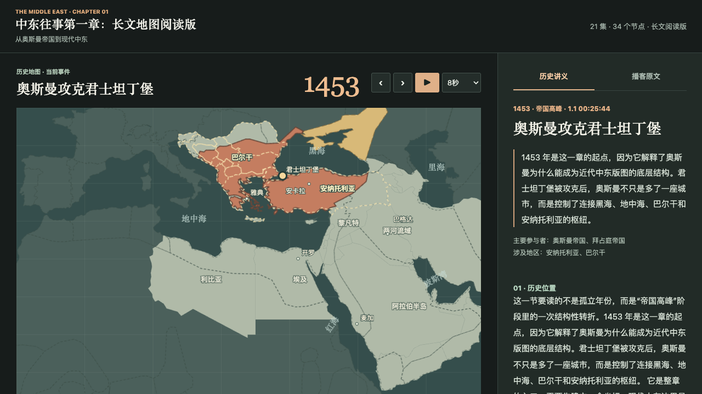

# 中东往事 · 时间线地图版

把《中东往事》第一章整理成可以阅读、检索和自动播放的历史地图。

从奥斯曼帝国到现代中东，以 34 个时间节点串起事件、地理区域、版图变化与历史讲义。页面包含 21 集播客的语音转写，约 32.8 万字。



## 使用

下载仓库后，用浏览器打开 `index.html` 即可。地图、讲义、边界和转写均已内嵌，不需要安装依赖、启动后端或填写 API key。

- 点击横向时间线、拖动进度条，或使用前后按钮切换事件。
- 播放按钮按 5、8 或 12 秒的间隔推进事件。
- “当前地图年份”可以手动选择边界层；切换事件时会自动选择关联图层。
- 地图下方包含事件经过、版图与控制权、读图线索、参与者和影响。
- 右侧切换“历史讲义 / 播客原文”，原文区支持切换集数、搜索和关键词高亮。

## 文件

```text
index.html                    可直接打开的完整网页
data/events.json              节点、讲义、边界与转写数据
scripts/build_reading_map.py   Python 页面生成器
docs/reading-timeline.md       全部节点的长文讲义
docs/historical-gis-sources.md 历史边界来源与精度说明
docs/how-it-was-made.md        制作过程博客草稿
THIRD_PARTY_NOTICES.md         第三方内容来源及许可说明
```

## 重新生成

需要 Python 3.10 或更新版本，只使用标准库：

```bash
python3 scripts/build_reading_map.py
```

生成器读取 `data/events.json`，输出 `index.html` 和 `docs/reading-timeline.md`。修改事件事实字段或地图数据后，可以重新运行生成器。节点讲义的编辑入口为脚本中的 `DETAILS`。

现有转写已存于 JSON 中。可选：在本地 `transcripts/` 放入以 `1.1 `、`1.2 ` 等集数开头的 SRT 文件，生成器会重新导入转写；这个目录默认不提交到 Git。

## 历史地图精度

事件年份与底图数据年份并不总是一致，页面会分别标出。主要历史层如下：

| 页面阶段 | 边界数据年份 |
| --- | --- |
| 1453 君士坦丁堡陷落后的早期扩张 | 1500 |
| 16 世纪奥斯曼高峰 | 1600 |
| 1878 柏林会议后 | 1880 |
| 1913 巴尔干战争后 | 1914 |
| 1920 委任统治与塞夫尔方案时期 | 1920 |
| 1923 洛桑后 | 1930 |

虚线关注区域是讲解用的地理示意，不是经过逐年考证的疆界。转写由语音识别生成，人物与地名可能存在识别误差，讲义和索引也仍需历史校订。

## 来源

- 播客：[《中东往事》在小宇宙的页面](https://www.xiaoyuzhoufm.com/podcast/66abf8b07349f7a5572afaf2)，加州 101。
- 历史边界：[aourednik/historical-basemaps](https://github.com/aourednik/historical-basemaps)。
- 现代底图：[world-atlas](https://github.com/topojson/world-atlas)，基于 Natural Earth。

第三方内容的归属与许可证见 [THIRD_PARTY_NOTICES.md](THIRD_PARTY_NOTICES.md)。本仓库不包含音频、登录凭证或语音识别 API key。
